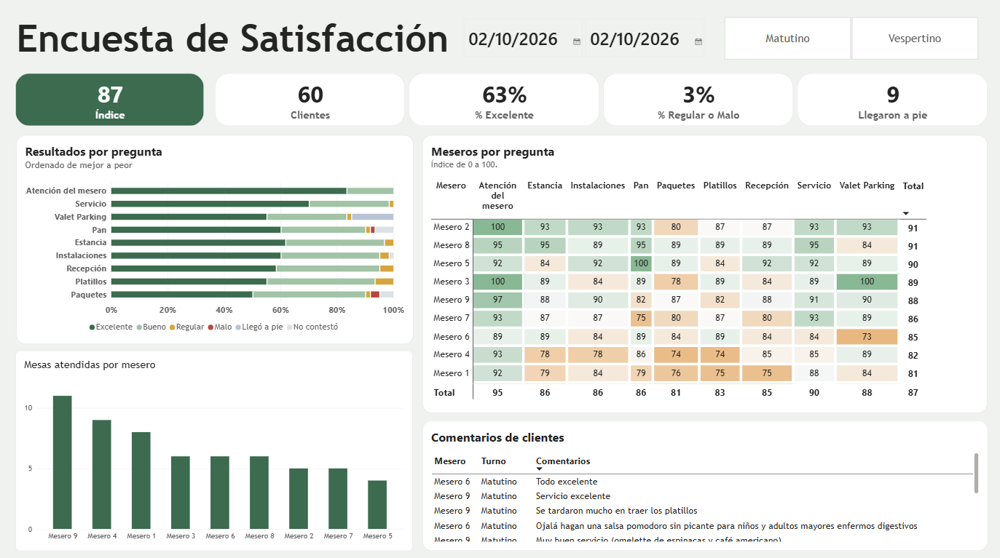
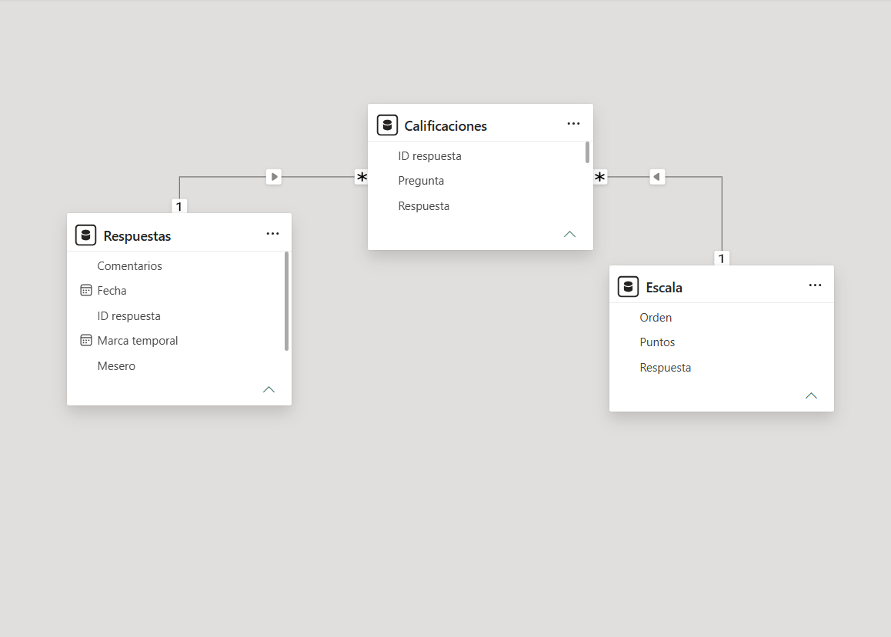
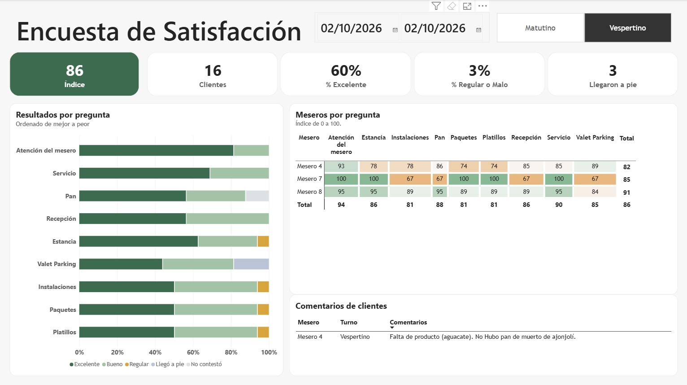

# Restaurant Customer Satisfaction Dashboard

Power BI dashboard that turns a Google Forms satisfaction survey into clear, actionable insights for a restaurant's management team.



## Business problem

The restaurant collected customer feedback through a survey with 9 questions (reception, service, food, facilities, valet parking, bakery, food packages, etc.), but the raw responses in a spreadsheet didn't show where the experience was failing or which servers needed support.

## Key insights

- **Overall satisfaction index: 87/100**, with 63% of ratings "Excellent" and only 3% "Fair" or "Poor".
- **Strongest area:** server attention (95). **Weakest areas:** food packages (81) and dishes (83).
- Customer comments point to **product availability issues** (items out of stock) and **slow or cold dishes**, which explains the lower food scores.
- Performance is consistent across shifts (morning 87, afternoon 86), but varies by server, which points to coaching opportunities rather than a shift-level problem.

## What I built

**Data preparation (Power Query)**
- Unpivoted the survey from wide format (one column per question) to long format (one row per answer), so new questions are included automatically.

**Data model (star schema)**
- `Calificaciones` (fact table, one row per answer), `Respuestas` (one row per customer) and `Escala` (rating scale), connected with one-to-many relationships.



**DAX measures**
```dax
Índice = AVERAGEX(Calificaciones, RELATED(Escala[Puntos]))

% Excelente = DIVIDE(
    CALCULATE([Calificaciones válidas], Escala[Respuesta] = "Excelente"),
    [Calificaciones válidas]
)
```
"Walked in" and "No answer" responses are excluded from the index, so services a customer didn't use don't lower the score.

**Design**
- Heat map that compares each server against the restaurant average (green above, orange below).
- Interactive filters by date and shift, and cross-filtering by clicking on a server.



## Data privacy

Server names were anonymized with a Python script (`anonimizar_datos.ipynb`) before publishing. All metrics are identical to the original data.

## How to open

1. Download or clone this repository.
2. Open `encuesta_portafolio.pbip` in Power BI Desktop.
3. If prompted, point the data source to `encuesta_anonimizada.xlsx` in this folder.

**Tools:** Power BI (Power Query, DAX), Python (pandas), Excel